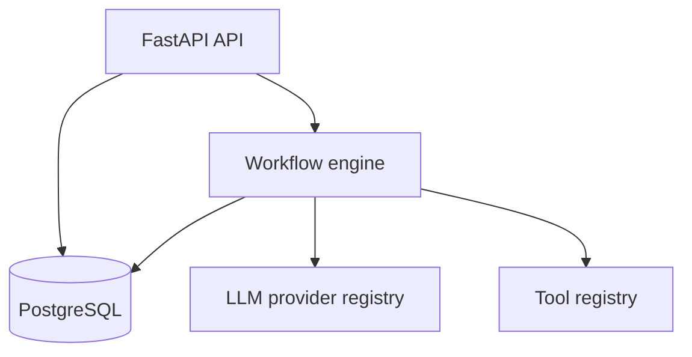

# Agent Runtime

Agent Runtime is a small, production-minded workflow engine for executing dependency-aware LLM and tool steps with durable state, retries, timeouts, idempotency, and step-level observability.

It deliberately implements the orchestration core without an agent framework. The result is compact enough to understand in an interview, while still addressing the failure modes that appear when AI workflows leave a notebook and enter production.

## What it demonstrates

- FastAPI API and typed Pydantic contracts
- PostgreSQL persistence with SQLAlchemy and Alembic
- Pluggable LLM providers and tool registry
- Optional OpenAI and Anthropic providers configured from the environment
- Provider and tool discovery without exposing credentials or implementation internals
- Workflow creation preflight for unknown provider and tool names
- Side-effect-free workflow validation for authoring clients
- Cursor-paginated workflow run history with complete step telemetry
- Explicit step dependencies with bounded parallel DAG branches
- Durable human approval gates with audited approve/reject decisions
- Ordered LLM provider fallback with selected-provider telemetry
- Sanitized permanent/transient provider errors with retry-aware execution
- Bounded provider `Retry-After` support for throttling and server cooldowns
- Optional per-provider call timeouts that preserve fallback opportunities
- Provider-specific timeout overrides for heterogeneous fallback chains
- Retry-local memory that stops recalling permanently failed providers
- Deterministic local execution without API credentials
- Exponential retry backoff and per-step timeouts
- Optional workflow-wide execution time, token, and estimated cost budgets
- Idempotent run creation under concurrent requests
- Optional deferred execution through database workers with renewable leases
- Opt-in replay-safe recovery of expired worker leases, conservative by default
- Latency, token, cost, input, output, and error recording per step
- Prometheus HTTP, workflow execution, step attempt, and worker lifecycle metrics
- Database-backed queue depth and oldest-pending-age metrics
- Optional OpenTelemetry HTTP, workflow, and step traces exported over OTLP/HTTP, including
  W3C trace continuity across deferred worker execution
- Version-controlled JSONL evaluation datasets with a CI-friendly runner
- JSON structured logging, Docker Compose, tests, type checking, linting, and CI

## Architecture



A run executes in the API process by default and can be deferred to a database worker. Each step
resolves references from the run input or earlier step output, persists its state and telemetry, and
makes its output available to later steps. An approval step pauses either execution mode durably and
can be decided through the API.

See [architecture](docs/architecture.md) and [production considerations](docs/production-considerations.md) for the detailed design and trade-offs.

## Quick start with Docker

Requirements: Docker with Compose.

```bash
docker compose up --build
```

Open the API documentation at <http://localhost:8000/docs>. In another terminal, execute the end-to-end demo:

```bash
make demo
```

The demo creates a two-step workflow (fake LLM, then uppercase tool), runs it with an idempotency key, and prints the recorded run.

Prometheus metrics are available at <http://localhost:8000/v1/metrics>. They use HTTP method,
matched route template, and status code labels; concrete resource IDs are never used as labels.
The same endpoint includes workflow execution counts and duration by synchronous/worker mode and
resulting status, step attempts by type and result, current pending queue depth, and the age of its
oldest run. Queue gauges are refreshed from the database for every API scrape.

Because workers are separate processes, configure a dedicated scrape endpoint for each worker when
those metrics are needed:

```bash
WORKER_METRICS_HOST=127.0.0.1 WORKER_METRICS_PORT=9091 make worker
```

The worker endpoint exposes its workflow metrics together with claim, active-run, and expired-lease
recovery counters. Queue gauges are refreshed after each claim or idle poll and on active-run
heartbeats. It is disabled when `WORKER_METRICS_PORT` is absent. Use a distinct port per worker and
expose it beyond loopback only behind appropriate network controls.

To export traces from both the API and worker, set a complete OTLP/HTTP traces endpoint and restart
the processes:

```bash
OTEL_EXPORTER_OTLP_TRACES_ENDPOINT=http://localhost:4318/v1/traces
OTEL_SERVICE_NAME=agent-runtime
```

Tracing is disabled when the endpoint is absent. HTTP server spans contain standard semantic
attributes; `workflow.run` and child `workflow.step` spans add run/workflow IDs and operational
state. Deferred runs persist only `traceparent` and `tracestate`, allowing worker spans to continue
the enqueue or approval trace after the database handoff. Engine spans deliberately exclude inputs,
prompts, outputs, credentials, baggage, and error messages. The OpenTelemetry SDK also honors its
standard sampler and OTLP header environment variables.

## Local development

Requirements: Python 3.12 and [uv](https://docs.astral.sh/uv/).

```bash
cp .env.example .env
uv sync --extra dev
docker compose up -d db
uv run alembic upgrade head
uv run uvicorn app.main:app --reload
```

For dependency-free experimentation, omit `.env`; development defaults to a local SQLite database and creates tables automatically.

## API example

Create a workflow:

```bash
curl -X POST http://localhost:8000/v1/workflows \
  -H 'Content-Type: application/json' \
  -d '{
    "name": "Reliable writer",
    "definition": {"max_runtime_seconds": 60, "max_total_tokens": 5000, "max_estimated_cost_usd": 1, "steps": [
      {"key": "draft", "type": "llm", "provider": "fake", "input": "Explain ${input.topic}"},
      {"key": "publish", "type": "tool", "tool": "uppercase", "depends_on": ["draft"], "input": "${steps.draft.output}"}
    ]}
  }'
```

Run it, replacing `<workflow-id>`:

```bash
curl -X POST http://localhost:8000/v1/workflows/<workflow-id>/runs \
  -H 'Content-Type: application/json' \
  -H 'Idempotency-Key: article-001' \
  -d '{"inputs":{"topic":"reliable AI systems"}}'
```

To enqueue the run instead of executing it in the API process, add
`Prefer: respond-async` and start a worker in another terminal:

```bash
make worker
```

The API returns `202 Accepted` with a pending run. Workers claim pending runs in creation order
using a row lock, so multiple worker processes can poll without executing the same run. Each claim
records a worker ID and lease deadline; the worker extends the lease with periodic heartbeats and
releases it after the run finishes. Before claiming new work, workers inspect expired runs. The
default remains conservative: an interrupted step is marked failed and is not replayed.

A provider or tool step may opt into recovery with `"replay_safe": true`. When every interrupted
step in an expired run has that declaration, the worker requeues the run, preserves completed
checkpoints, and reuses each incomplete `StepRun` with a cumulative attempt count. A step should be
declared replay-safe only when repeating its external call is acceptable. For side effects, pass
`${runtime.operation_key}` to a downstream idempotency header, unique constraint, or outbox and
enforce it there. The declaration is an operator-owned contract; the runtime cannot verify the
external system. Approval steps cannot use `replay_safe` because they wait without holding a lease.

References support `${input.<key>}`, `${steps.<step-key>.output}`, and runtime context values:
`${runtime.run_id}`, `${runtime.step_key}`, and `${runtime.operation_key}`. The operation key has the
stable form `run_id:step_key`, so a side-effecting tool can pass it to a downstream idempotency
header or unique constraint. It stays unchanged across retries and safe workflow resumptions. A
reference occupying the entire value preserves JSON types; references embedded in text are
stringified. Supplying a key does not make a tool idempotent by itself—the downstream operation must
enforce it.

Run history is available from `GET /v1/workflows/<workflow-id>/runs`. Results are ordered newest
first and include the same step telemetry as direct run lookup. The response contains up to 20
items by default, accepts `limit` from 1 to 100, and returns `next_cursor` when another page exists.
Pass that opaque run ID as `cursor` on the next request; cursors are valid only for their workflow.
Use the optional `status` query parameter to select lifecycle states: `pending`, `running`,
`waiting`, `completed`, or `failed`. Repeat the parameter to combine states, such as
`?status=pending&status=running&status=waiting`, and keep the same values while following a cursor.
Use `created_from` and `created_before` for a half-open creation-time interval: the lower bound is
inclusive and the upper bound is exclusive. Both accept RFC 3339 timestamps with a required UTC
offset. Repeat the same bounds while following `next_cursor`.
Use `completed_from` and `completed_before` with the same interval and timezone rules to select runs
that became terminal during a period. Pending, running, and waiting runs have no completion time and
are therefore excluded whenever either completion bound is present.
Use `idempotency_key` for an exact, workflow-scoped lookup after a client loses the original create
response. A missing key returns an empty page; the filter never creates or re-executes a run.

Steps may declare `depends_on` keys and can appear in any declaration order. The runtime rejects
unknown, duplicate, self-referential, and cyclic dependencies before persistence, then executes a
stable topological plan using declaration order to break ties. A definition that uses dependencies
must converge on exactly one terminal step, whose output becomes the run output.

Set `max_parallel_steps` between `2` and `10` to execute dependency-ready steps concurrently; the
default of `1` preserves serial execution. The engine runs bounded waves and never shares its
SQLAlchemy session with concurrent tasks: it records running steps before a wave, executes only the
provider/tool calls concurrently, then fences the worker lease and persists every sibling result in
one serialized boundary. If a branch fails, already-started siblings finish and remain inspectable,
while dependent waves do not start. Time budgets share one deadline. Token and cost budgets are
checked between waves, so one parallel wave can exceed the remaining budget before all its usage is
known.

Use a step with `"type": "approval"` to place a durable human gate in the plan. Its `input` is
resolved and stored as the review context, then the run moves to `waiting` without starting later
steps. Approval steps are exclusive waves: ready work declared before the gate may finish, while
work after it waits for a decision. They do not accept provider, tool, timeout, fallback, or custom
retry settings.

Record a decision with the waiting run ID:

```bash
curl -X POST http://localhost:8000/v1/runs/<run-id>/approval \
  -H 'Content-Type: application/json' \
  -d '{"decision":"approve","comment":"Reviewed by release manager"}'
```

`approve` stores the decision on the approval step and resumes from completed step history without
replaying prior work. `reject` marks both the step and run failed and never starts later steps. Only
one decision wins: a later request receives `409 Conflict`. The optional comment is limited to 1,000
characters. A workflow time budget covers each active execution segment; time spent waiting for a
person is excluded and a fresh active deadline begins when the run resumes.

For a durable continuation, add `Prefer: respond-async` to an approve request. The API records the
decision, moves the run to `pending`, and returns `202 Accepted`; a database worker then claims it,
rebuilds prior outputs and budget usage from completed steps, and executes only the remaining plan.
The preference is ignored for rejection because rejection is already a terminal state.

Set `max_runtime_seconds` on a workflow definition to bound elapsed engine time across its steps and
retry backoffs. This budget applies in both synchronous and worker execution; per-step
`timeout_seconds` continues to bound each individual attempt. Provider/tool calls are cancelled at
the deadline, while an active database transaction is allowed to reach a safe boundary.

Set `max_total_tokens` to bound the cumulative prompt and completion tokens reported by successful
LLM calls. Once the exact limit is consumed, tool steps may still run but another LLM call will not
start. Because usage is known only after a response, one call can exceed the remaining budget; that
completed step and its usage remain inspectable while the run fails before executing later steps.

Set `max_estimated_cost_usd` to apply the same cumulative guardrail to normalized provider cost.
Hosted-provider pricing changes independently of this runtime, so configure both current input and
output rates per million tokens with the corresponding `OPENAI_*_COST_PER_MILLION_TOKENS_USD` or
`ANTHROPIC_*_COST_PER_MILLION_TOKENS_USD` environment variables. The runtime never ships a stale
price catalog. A workflow with a cost budget fails closed after a successful LLM call whose provider
cannot report a cost. As with tokens, actual usage is known only after the response, so one call may
exceed the remaining budget and remains recorded for inspection.

## Evaluation datasets

Store deterministic cases as JSON Lines, one case per line. Each case needs a unique `id`, workflow
`inputs`, and an `expected_output` JSON value:

```json
{"id":"uppercase-hello","inputs":{"text":"hello"},"expected_output":"HELLO"}
{"id":"uppercase-runtime","inputs":{"text":"agent runtime"},"expected_output":"AGENT RUNTIME"}
```

Run the dataset against a persisted workflow whose final output matches those expectations:

```bash
curl -X POST http://localhost:8000/v1/workflows \
  -H 'Content-Type: application/json' \
  --data @examples/uppercase-workflow.json
uv run agent-evaluate <workflow-id> examples/uppercase-evaluation.jsonl
```

Use `--api-url` for a non-local runtime and `--timeout-seconds` for longer synchronous runs. The
command prints a JSON summary containing each run ID plus expected and actual outputs. It exits `0`
when every case passes, `1` for expectation failures, and `2` for dataset, HTTP, or configuration
errors. Cases run sequentially and create normal persisted runs; datasets are limited to 1,000 cases.
Comparison is exact JSON equality, without model-based or fuzzy scoring.

## Quality checks

```bash
make check
```

This runs Ruff lint/format checks, strict mypy, and the pytest suite with coverage.

## Built-in extensions

LLM providers implement the `LLMProvider` protocol and are registered in `ProviderRegistry`. An
LLM step can define up to five ordered `fallback_providers`; the first successful provider is stored
on the step run. Tools are async callables registered in `ToolRegistry`. The runtime ships `fake`,
`echo`, `uppercase`, and `extract_field` implementations. Set `OPENAI_API_KEY` to register the
`openai` provider; `OPENAI_MODEL` defaults to `gpt-5-mini`. The key is read from the process
environment and is never stored in a workflow or run. Set `ANTHROPIC_API_KEY` to register the
`anthropic` provider; `ANTHROPIC_MODEL` defaults to `claude-sonnet-5` and
`ANTHROPIC_MAX_TOKENS` defaults to `4096`. To record cost estimates, configure both input and output
per-million-token rates for that provider; partial rate configuration is rejected at startup.

Workflow creation validates every LLM provider, fallback provider, and tool name against the API
process's current registries. Unknown names return `422` together in a deterministic
`unknown_workflow_extensions` detail and the workflow is not persisted. This is configuration
preflight, not an upstream provider health check.

`POST /v1/workflows/validate` applies the same structural and extension checks to the creation
contract without persisting a workflow. A valid definition returns `{"valid": true}`. Validation
does not contact providers, invoke tools, or execute the workflow, so it is not an execution dry-run.

The OpenAI and Anthropic adapters classify transport failures, HTTP `408`, `409`, `425`, `429`, and
`5xx` responses as transient. Other HTTP failures and invalid successful responses are permanent.
Every configured fallback is still attempted, but the engine skips later step retries when the
entire provider chain failed permanently. Error messages contain the provider, status or exception
class only; response bodies and network details are not persisted or logged. Transient responses
may supply `Retry-After` as delay-seconds or an HTTP date. The retry loop uses the largest hint from
the failed fallback chain without shortening its own exponential backoff, capped by
`PROVIDER_RETRY_AFTER_MAX_SECONDS` (default `60`, maximum `3600`). Workflow-wide time budgets still
bound the wait.

An LLM step may set `provider_timeout_seconds` (greater than zero and at most `300`) to
independently bound each provider call. A timed-out call is cancelled locally, classified as
transient, and the engine continues to the next configured fallback. The step's `timeout_seconds`
still bounds the complete provider chain for one attempt, so later fallbacks receive only the time
remaining in that outer limit. Omitting `provider_timeout_seconds` preserves the original shared
step-timeout behavior.

Use `provider_timeout_overrides` when providers in the same chain need different limits. The map
accepts at most six entries, each key must name the primary provider or one of its fallbacks, and
each value must be greater than zero and at most `300`. A matching override takes precedence over
`provider_timeout_seconds`; providers without an override inherit that shared default, or rely only
on the outer step timeout when no default is configured.

When a fallback chain mixes permanent and transient failures, later attempts of that same step skip
providers that already failed permanently and retry only the remaining candidates. The memory is
scoped to one active step execution: it is not shared between runs, between steps, or persisted
across a worker crash and replay-safe recovery.

## API endpoints

| Method | Path | Purpose |
|---|---|---|
| `GET` | `/v1/health` | Liveness check |
| `GET` | `/v1/metrics` | Prometheus HTTP RED metrics |
| `GET` | `/v1/providers` | List provider names available to this runtime |
| `GET` | `/v1/tools` | List allowlisted tool names available to this runtime |
| `POST` | `/v1/workflows/validate` | Validate a workflow without persisting it |
| `POST` | `/v1/workflows` | Validate and persist a workflow |
| `GET` | `/v1/workflows` | List workflows |
| `GET` | `/v1/workflows/{id}` | Inspect a workflow |
| `GET` | `/v1/workflows/{id}/runs` | List and filter run history with cursor pagination |
| `POST` | `/v1/workflows/{id}/runs` | Execute a run, or enqueue it with `Prefer: respond-async` |
| `GET` | `/v1/runs/{id}` | Inspect a run and all step telemetry |
| `POST` | `/v1/runs/{id}/approval` | Approve or reject the run's pending human gate |

## Roadmap

- v0.2: database workers, leases, terminal and opt-in replay-safe recovery, worker-backed approval continuation, and stable operation keys delivered
- v0.3: provider fallback plus OpenAI and Anthropic adapters delivered; encrypted credentials next
- v0.4: dependency-aware DAG planning, bounded parallel branches, and human approval steps delivered
- v0.5: Prometheus HTTP/workflow/worker metrics, workflow time/token/cost budgets, OpenTelemetry traces, and a JSONL evaluation runner delivered

## License

MIT
