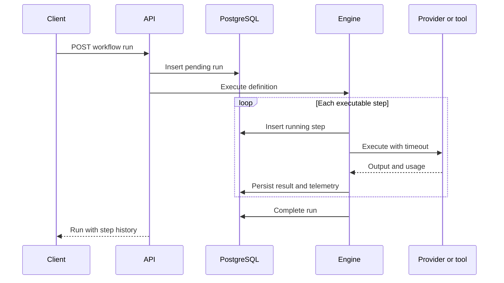
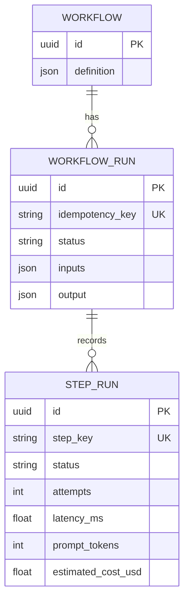

# Architecture

## Goals

Agent Runtime v0.1 provides the smallest end-to-end slice of a durable AI workflow system: validated workflow definitions, sequential execution, persistent run history, failure policies, and telemetry. It favors explicit interfaces and inspectable code over a broad feature set.

## Execution lifecycle

1. The API validates a workflow definition with Pydantic before persisting it.
2. A client creates a run with inputs and an optional `Idempotency-Key` header.
3. A unique database constraint guarantees one run per workflow and idempotency key, including races.
4. The engine creates a stable topological plan and resolves input references immediately before each step.
5. Each attempt runs under `asyncio.wait_for`; retry delay grows exponentially.
6. State and telemetry are committed around execution boundaries so a failure remains inspectable.
7. The terminal step output becomes the workflow output.

An approval step replaces the target call with a durable boundary: the engine stores its resolved
review context, changes the step and run to `waiting`, and returns. A later approve decision is
stored as the step output before the same engine reconstructs prior outputs and resumes. Rejection
terminalizes the step and run without executing descendants.

Approval can resume immediately in the API process or, with `Prefer: respond-async`, transition the
run back to `pending` and return `202 Accepted`. The normal worker claim path then leases the run and
invokes the same resume-aware engine. Queueing the continuation is an explicit client choice so the
existing synchronous API remains backward compatible.

## Components

### API

`app/api.py` owns HTTP behavior only: validation, resource lookup, idempotent creation, and response serialization. It does not know provider-specific details.

An ASGI middleware records Prometheus request counts, duration, and current concurrency. Labels use
the matched route template rather than the request path, so workflow and run IDs cannot create an
unbounded time-series set. The scrape endpoint is excluded from its own metrics.

When `OTEL_EXPORTER_OTLP_TRACES_ENDPOINT` is set, FastAPI instrumentation creates HTTP server spans
and exports them in batches over OTLP/HTTP. Synchronous `workflow.run` spans inherit that request
context; worker runs start a new root trace. Every `workflow.step` span is a child of its run span.
The engine adds identifiers, execution mode, status, step type, attempt count, and selected provider,
but never adds inputs, prompts, outputs, credentials, or error messages. With no endpoint, the
runtime does not install a tracer provider, exporter, or background processor.

### Domain and persistence

`Workflow` stores the immutable definition used for new runs. `WorkflowRun` stores lifecycle state and final output. `StepRun` is both the audit trail and the unit of observability, including attempt count, latency, tokens, cost, and error.

### Execution engine

`WorkflowEngine` is an application service rather than a web concern. It accepts a database session, run, and validated definition, so it can later be invoked by a queue worker without changing the workflow semantics.

Definitions can declare dependency edges between steps. Validation rejects unknown, duplicate,
self-referential, and cyclic edges, and dependency-aware definitions must converge on one terminal
step that supplies the run output. The planner uses declaration order as a deterministic tie-breaker
for simultaneously ready nodes. By default the engine remains serial; `max_parallel_steps` can opt
into bounded waves of concurrent provider and tool calls.

Parallel tasks never access the SQLAlchemy session. The engine persists the wave's running records,
launches external calls, waits for every sibling, verifies an active worker lease when applicable,
and commits all terminal step states through the owning coroutine. A branch failure prevents later
waves but does not discard successful sibling telemetry. Wall-clock limits share one deadline;
cumulative token and cost limits are reconciled after a wave and may therefore overshoot by the
usage of all calls already in flight.

Approval steps are exclusive waves in the dependency-ready plan. Declaration order remains the
tie-breaker: ready work before a gate can complete, the gate then pauses the run, and ready work
after it cannot start early. When execution resumes, the engine rebuilds references and cumulative
token/cost accounting from completed `StepRun` records. The `(run_id, step_key)` uniqueness
constraint also prevents a resume path from duplicating a completed step. Human waiting time is
outside the active execution deadline; `max_runtime_seconds` starts a fresh active segment on each
resume.

### Evaluation runner

`agent-evaluate` loads version-controlled JSONL cases and submits each case to the existing
synchronous run endpoint. It compares the final output with `expected_output` using exact JSON
equality and emits a machine-readable summary with a CI-compatible exit status. Evaluation does not
have a privileged execution path: each case creates the same durable run history, telemetry,
budgets, and provider calls as any other API request. Cases execute sequentially to keep ordering and
resource use predictable.

### Providers and tools

The provider boundary returns a normalized `LLMResult`, preventing provider response shapes from leaking into the engine. The tool boundary is intentionally narrow: an async callable from JSON-compatible input to output. Registries use explicit allowlists, so workflow definitions cannot import arbitrary Python code.

LLM steps may declare an ordered fallback chain. The engine tries the primary provider followed by
each fallback within the existing step timeout and retry boundary. Only the successful provider is
persisted on `StepRun`; failed provider attempts emit structured logs without provider exception
messages, reducing the chance of logging sensitive response data.

When `OPENAI_API_KEY` is configured, the provider registry also exposes `openai`. Its adapter calls
the Responses API with storage disabled, passes run and step IDs as metadata, and normalizes text and
token usage into the same `LLMResult` used by the fake provider. Credentials remain process-level
configuration and are not part of persisted workflow definitions.

OpenAI and Anthropic cost estimates use operator-supplied input and output rates per million tokens.
The rates are paired process configuration rather than persisted workflow data or a hardcoded price
catalog. This keeps model selection and pricing policy with the deployer while preserving a common
`estimated_cost_usd` field for engine enforcement and telemetry.

The `anthropic` adapter is registered under the same rule when `ANTHROPIC_API_KEY` is present. It
calls the Messages API with a bounded output-token budget and normalizes text blocks and token usage.
Non-text blocks such as model thinking remain outside the runtime's provider-neutral result shape.

## Reference model

Steps can refer to `${input.key}`, `${steps.step-key.output}`, `${runtime.run_id}`,
`${runtime.step_key}`, or `${runtime.operation_key}`. Runtime values are derived by the engine for
the current step; the operation key is `run_id:step_key`. References are resolved recursively inside
dictionaries and lists before the first attempt, so every retry and safe resume uses the same
resolved operation key. Full-value references preserve their JSON type; interpolation into a larger
string produces text.

This intentionally avoids an embedded expression language in v0.1. Expression engines add attack surface, nondeterminism, and a second programming model.

## Failure semantics

- Provider and tool calls have bounded timeouts.
- Invalid or ambiguous dependency graphs are rejected before a workflow is persisted.
- A workflow may define a cumulative wall-clock budget across calls and retry backoffs.
- A workflow may bound cumulative tokens reported by successful LLM calls.
- A workflow may bound cumulative estimated cost reported by successful LLM calls.
- A retry policy controls maximum attempts and exponential backoff.
- A failed step fails the run and prevents later steps from executing.
- A rejected approval fails the run and prevents later steps from executing.
- An approval decision is accepted only while exactly one approval step is waiting.
- Completed prior steps are retained for diagnosis.
- Error strings are recorded; production adapters must redact secrets before raising.

The workflow budget and step timeout are independent: the smaller remaining duration controls each
attempt. Exhausting the workflow budget cancels the active call, marks that step and the run failed
with `WorkflowTimeBudgetExceededError`, and prevents later steps from starting. The engine checks the
deadline at safe boundaries; it allows an active database transaction to finish, and that elapsed
time reduces the budget available to the next call.

The token budget sums prompt and completion usage after each successful LLM response. Reaching the
limit prevents another LLM call but does not block tool-only work. A response can exceed the
remaining budget because usage is not known in advance; in that case the completed step and its
usage are retained, the run fails with `WorkflowTokenBudgetExceededError`, and later steps do not
start. Provider failures that do not return normalized usage cannot be charged.

The cost budget mirrors those boundaries using each successful step's normalized
`estimated_cost_usd`. Reaching the exact limit permits tool steps but prevents another LLM call; a
single response may overshoot and remains recorded before the run fails with
`WorkflowCostBudgetExceededError`. If a cost-budgeted workflow receives a successful response with
no cost estimate, it fails closed with `WorkflowCostUnavailableError`. This prevents silently
bypassing the guardrail when a custom, fallback, or unpriced provider is selected.

## Data model

## Execution modes

Execution remains synchronous by default, preserving the simple local demo. Clients can send
`Prefer: respond-async` to persist a pending run and receive `202 Accepted`; an `agent-worker`
process claims the oldest pending run with `FOR UPDATE SKIP LOCKED` and invokes the same engine.
The database is the initial queue so run creation and claim state share one transaction boundary.
Each claim stores a worker ID, heartbeat timestamp, and lease deadline. A separate database session
renews the lease during execution so provider calls do not block heartbeats.

Before claiming new work, a worker locks expired runs in bounded batches and marks each run plus
its incomplete steps as failed. Clearing ownership fences out the previous worker. Before persisting
a step result, every leased worker locks the run row and verifies that its ownership and deadline
are still valid, preventing a late result from overwriting recovery. The runtime does not replay the
interrupted step: resumable recovery is separate because external side effects cannot be repeated
blindly.
